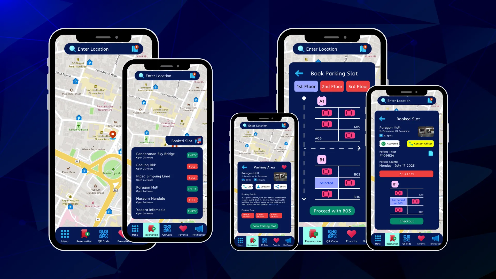
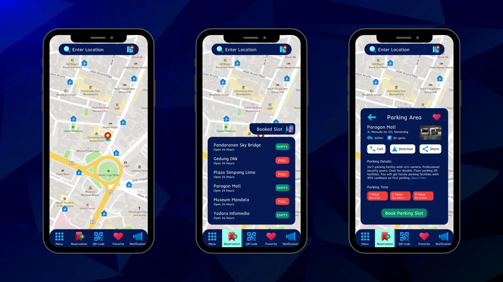

# E-Parking Mobile App UI/UX Design




-green)


## Project Overview

E-Parking is an end-to-end mobile application UI/UX design project engineered to solve urban vehicular congestion and eliminate parking discovery friction in bustling metropolitan and commercial centers. By translating complex real-time occupancy data into an intuitive, dark-mode mobile interface, the application empowers drivers to quickly locate nearby parking facilities, verify live bay availability, reserve multi-level parking slots in advance, track elapsed parking duration via active countdown timers, and execute frictionless cashless payments directly from their smartphones.

## Problem Statement & Objectives

Urban motorists in dense commercial districts routinely lose significant time and fuel circling packed parking structures due to a lack of pre-arrival occupancy visibility. Traditional parking operations rely heavily on physical paper tickets, cash-only payment booths, and ambiguous indoor signage, which cause severe traffic bottlenecks at entry and exit gates, heighten driver anxiety, and increase the risk of parking violations or unexpected overstay penalties.

- Deliver immediate visual transparency regarding parking facility capacity (`EMPTY` vs. `FULL` indicators) prior to driver arrival.
- Provide interactive multi-floor bay selection grids enabling motorists to reserve specific parking slots on designated levels.
- Offer an active digital parking ticket equipped with live countdown timers and instant security officer assistance hotlines.
- Enable transparent cost calculation and streamlined mobile checkout to eliminate exit barrier queuing.
- Implement a modern, high-contrast visual interface optimized for effortless one-handed operation and quick glanceability inside vehicles.

## Project Type & Design Approach

The project follows a rigorous User-Centered Design (UCD) approach tailored specifically for mobile mobility and navigation interfaces. The design process focused on minimizing driver cognitive load through clean visual hierarchy, distinctive color coding, high-contrast dark-mode surfaces, and predictable bottom-sheet navigation patterns that facilitate rapid decision-making on the road.

| Attribute | Description |
| :--- | :--- |
| Project Type | Mobile App Design |
| Supporting Discipline | Product Design & Interaction Design |
| Design Approach | User-Centered Design (UCD) |
| Target Platform | Mobile (iOS & Android) |
| Primary Tool | Figma |
| Main Deliverable | High-Fidelity Interactive UI Screens & Design System |

## Target Audience & User Needs

The primary user base consists of urban vehicle owners, daily office commuters, and commercial visitors navigating congested downtown districts, retail shopping centers, and business hubs.

- Pre-arrival awareness of available parking bays to avoid unnecessary detours and congested facilities.
- Transparent hourly rate schedules and amenity disclosures (e.g., CCTV security, disabled access, covered parking).
- Spatial floor plan orientation to easily identify and secure parking bays close to elevators or exits.
- Persistent session tracking showing exact elapsed parking time and accrued fees.
- Reliable digital ticketing to replace easily misplaced paper stubs.

### User Research & Insights

User research was conducted through contextual observations and structured commuter interviews to uncover real-world parking behaviors and pain points across metropolitan parking hubs.

| Method | Purpose | Evidence / Source | Key Findings |
| :--- | :--- | :--- | :--- |
| Contextual Inquiry | Observe driver behavior during peak parking hours | 12 drivers observed at commercial mall garages | Drivers spend 15–20 minutes circling parking lanes due to zero vacancy visibility at facility entrances. |
| User Interviews | Identify pain points with existing physical parking systems | 18 daily automobile commuters | 78% of motorists reported anxiety over lost paper tickets, cash booth delays, and lack of timer reminders. |
| Competitive Benchmarking | Analyze usability and spatial mapping in mobility apps | Audit of 4 regional parking and transport apps | Most existing apps offer generic venue listings without granular floor-level slot selection or live session counters. |

### User Personas & Journey Mapping

Two archetypal user personas were developed to represent core user mindsets, operational environments, and parking goals.

| Persona | Role / Segment | Core Goals | Primary Pain Points |
| :--- | :--- | :--- | :--- |
| **Budi Santoso** (32) | Corporate Professional & Daily Commuter | Check real-time lot vacancy before reaching meetings; book bays in advance; pay digitally. | Unpredictable parking congestion; late arrival at client meetings; misplaced physical tickets. |
| **Maya Indah** (28) | Weekend Shopper & Family Driver | Find accessible parking bays on lower levels; track parking duration; review itemized receipts. | Navigating dim underground ramps; losing track of elapsed parking time and incurring unexpected fees. |

## Design Scope & Deliverables

The design scope encompasses complete high-fidelity mobile user flows from discovery to checkout, complemented by modular component architectures and mobile UI specifications.

| Deliverable | Description | Status / Location |
| :--- | :--- | :--- |
| Interactive Map Discovery | Full-screen interactive map interface with contextual search and location pins | Completed / `screenshot/banner.webp`, `screenshot/image1.webp` |
| Parking Hub Directory | Bottom sheet modal displaying real-time vacancy badges (`EMPTY`/`FULL`) and facility stats | Completed / `screenshot/image1.webp` |
| Venue Detail & Duration Modal | Comprehensive venue card featuring amenities, distances, and duration pricing options | Completed / `screenshot/image1.webp` |
| Multi-Floor Bay Reservation Grid | Interactive bay floor plan showing available, occupied, and selected parking bays | Completed / `screenshot/image2.webp` |
| Active Parking Ticket Dashboard | Live digital ticket featuring real-time countdown counter, slot details, and officer hotline | Completed / `screenshot/image2.webp` |
| Checkout & Payment Confirmation | Billing summary breakdown with parking duration, itemized charges, and payment triggers | Completed / `screenshot/image2.webp` |

### Information Architecture & Sitemap

The application architecture organizes user interactions into five primary navigation hubs accessible via a persistent bottom navigation bar, ensuring flat navigational depth and rapid access to core booking actions.

```
E-Parking Mobile App
├── Map Discovery View
│   ├── Geolocation Centering & Landmark Pins
│   └── Destination Search Bar
├── Parking Facility Hub (Bottom Sheet)
│   ├── Real-Time Vacancy Directory (EMPTY / FULL)
│   └── Venue Detail View (Amenities, Rates, Call / Direction / Share)
├── Slot Reservation Engine
│   ├── Floor Level Switcher (1st Floor, 2nd Floor, 3rd Floor)
│   └── Interactive Bay Grid (Available, Occupied, Selected Bay B03)
├── Active Session Management
│   ├── Digital Ticket (#109824) & Activation Status
│   ├── Live Countdown Counter (HH:MM:SS)
│   └── Contact Officer Quick Action
└── Billing & Checkout
    ├── Session Duration Summary (1:00 PM – 4:00 PM)
    ├── Itemized Cost Breakdown (IDR 15,000 Total)
    └── Cashless Payment Method Selection
```

### Design System & Component Library

A cohesive, scalable design system was developed in Figma to maintain strict visual consistency across dark mode surfaces and high-contrast alert states.

| Component / Token | Type / Purpose | Implementation Standard |
| :--- | :--- | :--- |
| **Surface Midnight Navy** (`#0B1E36`) | Canvas & Card Backgrounds | Dark theme foundation reducing eye fatigue in dim parking garages |
| **Emerald Neon** (`#00C48C`) | Positive State & Primary CTA | High-contrast accent for `EMPTY` badges, booked slots, and checkout triggers |
| **Vibrant Crimson** (`#EF4444`) | Alert & Occupancy Indicator | High-visibility warning hue for `FULL` status chips and occupied vehicle bays |
| **Electric Blue** (`#3B82F6`) | Interactive Highlight | Distinguishes active floor level selectors and map route indicators |
| **Warning Gold** (`#FACC15`) | Support & Hotline CTA | Dedicated accent for the `Contact Officer` quick-help button |
| **Parking Bay Tile** | Interactive Grid Component | 44x44pt minimum touch target with distinct vehicle outline states |
| **Vacancy Status Chip** | Pill Badge Component | Rounded capsule chips with uppercase typography for rapid status scanning |

## Design Solution & Key Features

E-Parking addresses commuter parking friction through a series of interconnected, user-tested visual solutions:

- **Contextual Map Exploration**: Interactive geospatial map centered on urban landmarks with immediate search input and venue pin clusters.
- **Glanceable Vacancy Indicators**: Instant color-coded status pills (`EMPTY` in emerald green, `FULL` in crimson red) allowing drivers to evaluate destination availability in seconds.
- **Detailed Venue Amenities Card**: Quick access to operating hours (24/7), distance metrics (600m), available spaces (30 spots), CCTV surveillance, and one-tap calling/directions.
- **Interactive Multi-Level Bay Grid**: Bird's-eye indoor floor plan layout allowing users to select floors (1st, 2nd, 3rd Floor) and tap individual bays (e.g., Slot B03) with clear occupied vehicle indicators.
- **Live Active Parking Counter**: Dynamic real-time timer bar displaying remaining authorized parking duration, preventing accidental overtime charges.
- **Digital Ticketing & On-Site Assistance**: Dedicated digital ticket code (`#109824`) paired with an instant `Contact Officer` button for immediate security desk communication.
- **Transparent Cashless Checkout**: Itemized billing screen displaying parking time windows, hourly tariffs, taxes, and total costs prior to payment authorization.

### UX Writing & Content Strategy

Interface copy was written to be concise, actionable, and unambiguous, prioritizing legibility under brief glance durations while operating a vehicle.

| Interface Element | UX Copy | Purpose & Context |
| :--- | :--- | :--- |
| Search Input | *"Enter Location"* | Clear default prompt inviting immediate destination search |
| Lot Availability Chip | `EMPTY` / `FULL` | High-contrast binary status minimizing cognitive interpretation |
| Bay Confirmation CTA | *"Proceed with B03"* | Context-aware button label confirming the exact selected slot |
| Ticket Status Chip | `Activated` | Reassuring visual confirmation that the parking session is live |
| Assistance Action | *"Contact Officer"* | Explicit, human-centered label for on-site security support |
| Checkout Action | *"Checkout"* / *"Payment Method"* | Action-oriented step progression leading directly to transaction completion |

## Design Workflow

1. **Context Analysis & Problem Framing**: Investigated metropolitan parking challenges, congested commercial zones, and parking lot bottlenecks to establish core product requirements.
2. **User Flow & Information Structuring**: Mapped out the end-to-end user journey across discovery, bay selection, active countdown monitoring, and payment stages.
3. **Low-Fidelity Wireframing**: Sketched wireframe layouts focusing on bottom-sheet interaction ergonomics and spatial map balance for mobile thumb zones.
4. **Visual UI Design & Design System**: Constructed high-fidelity dark-mode screens in Figma utilizing an 8pt layout grid, modular color tokens, and geometric sans-serif typography.
5. **Interactive Prototyping & Flow Testing**: Linked interactive micro-interactions and transitions to validate bay selection feedback, floor switching, and checkout flows.

## Design Tools & Tech Stack

| Category | Tool / Technology | Purpose |
| :--- | :--- | :--- |
| UI/UX Design & Prototyping | Figma | Artboard design, auto-layout components, color tokens, and interactive screen prototypes |
| Brainstorming & User Flows | FigJam | User journey mapping, information architecture nodes, and stakeholder wireframing |
| Asset Optimization | WebP Pipeline | Lossless, lightweight image asset compression for rapid documentation loading |
| Typography Engine | Google Fonts (Poppins & Inter) | Clean geometric sans-serif typefaces ensuring high legibility on mobile screens |
| Mapping Reference | Vector Map Assets | Geospatial canvas framework for realistic urban navigation and landmark rendering |

## Design Preview

The design preview showcases the complete user experience of the E-Parking mobile application, demonstrating the end-to-end flow from venue discovery and status verification to multi-floor slot reservation, active ticket tracking, and cashless checkout.

### Location Exploration, Parking Directory, and Facility Details


### Floor Plan Slot Selection, Active Parking Ticket, and Payment Summary


### Usability Testing & Findings

Usability testing was conducted with target motorists using high-fidelity interactive prototypes to validate navigation speed, visual clarity, and task success rates.

| Test Focus Area | Evaluation Method | Observed Result | Design Iteration & Remediation |
| :--- | :--- | :--- | :--- |
| **Floor Level Discovery** | Moderated Task: Switch from Ground to 2nd Floor | 38% of initial users missed small floor selector dropdowns | Redesigned floor selector into prominent segmented tab pills (1st Floor, 2nd Floor, 3rd Floor) at the top of the grid. |
| **Slot Availability Clarity** | Unmoderated Task: Identify vacant vs. occupied bays | 100% of participants immediately distinguished green available bays from red occupied vehicle icons | Maintained strong color-contrast pairing and added explicit vehicle graphic silhouettes. |
| **Session Tracking Reassurance** | Post-task Interview: Active ticket screen evaluation | Users requested immediate clarification on how to resolve entry barrier issues | Integrated a prominent golden `Contact Officer` button and dynamic countdown counter directly on the ticket. |

## Contributing

Contributions, feedback, and design suggestions are welcome. Please follow the standard contribution workflow below:

1. Fork the repository.
2. Create a branch for the change (`git checkout -b feature/DesignImprovement`).
3. Make the changes.
4. Check that relevant design files, assets, and documentation are organized correctly.
5. Commit and push the branch (`git commit -m 'Add new design screen'`).
6. Open a pull request with a clear explanation and relevant previews when applicable.

## License

This project is licensed under the MIT License.
See the [LICENSE](LICENSE) file for details.

## Author & Contact

**Yohanes Dimas Pratama**

- GitHub: [github.com/weztcy](https://github.com/weztcy)
- Portfolio: [yohanesdimas.com](https://yohanesdimas.com)
- LinkedIn: [linkedin.com/in/yohanes-dimas](https://www.linkedin.com/in/yohanes-dimas)
