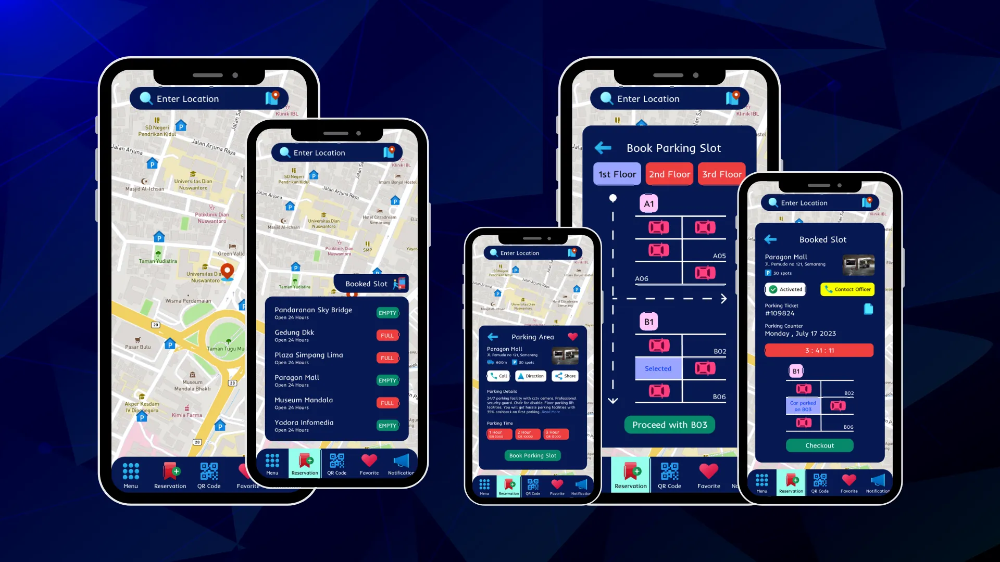
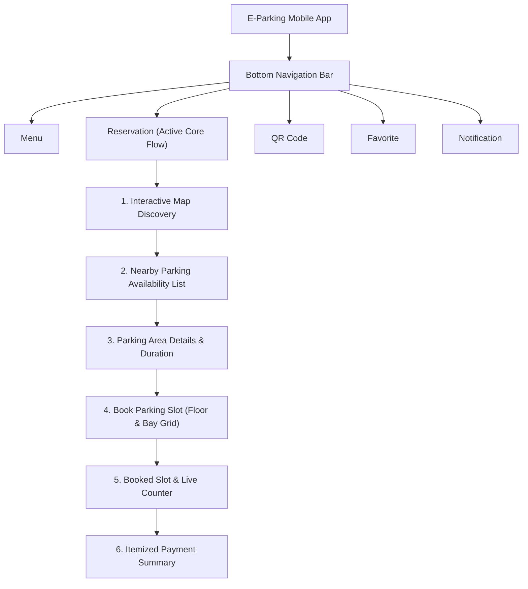
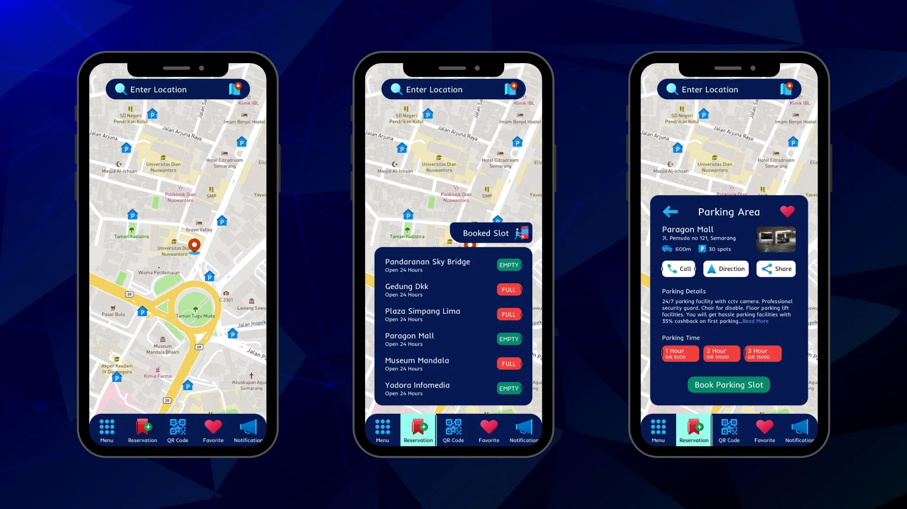
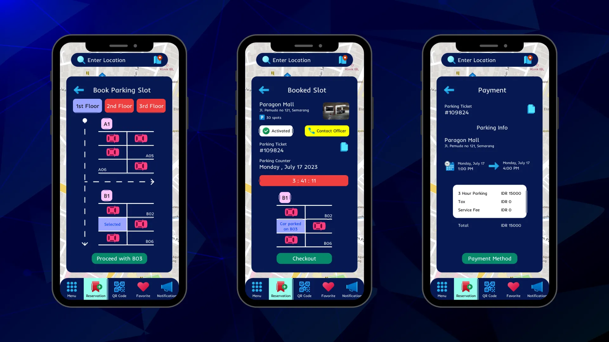

# E-Parking Mobile App UIUX Design

## Project Overview

E-Parking Mobile App UIUX Design is a high-fidelity mobile user interface and user experience design concept focused on streamlining urban vehicle parking discovery, slot reservation, and session checkout. Centered around city-scale map exploration in Semarang, Indonesia, the visual design guides drivers from locating nearby parking facilities to selecting specific floor bays, monitoring active parking timers, and reviewing itemized payment summaries within a unified dark-navy card interface.

## Problem Statement & Objectives

Drivers navigating busy urban commercial centers often experience uncertainty regarding real-time parking availability, floor-level bay locations, hourly tariff transparency, and checkout coordination. This design concept addresses those wayfinding and booking friction points by consolidating map discovery, slot selection, live session tracking, and digital payment into a single mobile workflow.

- Present nearby parking venues with immediate `EMPTY` and `FULL` availability indicators on a map-anchored interface.
- Provide transparent venue metadata including distance, remaining spot counts, operating hours, facility details, and upfront hourly pricing tiers.
- Enable granular floor-by-floor and bay-level slot selection before arriving at the parking structure.
- Maintain active session visibility with a persistent ticket identifier, live elapsed/countdown timer, parked bay indicator, and direct officer contact action.

## Project Type & Design Approach

This project is a mobile application UI/UX design concept delivered as high-fidelity visual screen compositions exported in WebP format. The design emphasizes high-contrast dark navy card overlays paired with semantic color coding to keep critical booking states legible over an interactive street map.

| Attribute | Description |
| :--- | :--- |
| Project Type | Mobile App Design |
| Supporting Discipline | Interaction & Visual Interface Design |
| Design Approach | User-Centered Task Flow Design |
| Target Platform | Mobile (iOS & Android) |
| Primary Tool | Figma (inferred standard vector UI workflow) |
| Main Deliverable | High-Fidelity Mobile UI Screen Exports (`screenshots/*.webp`) |

## Target Audience & User Needs

The interface is designed for urban private vehicle drivers seeking predictable, pre-reserved parking near commercial malls, office buildings, and public landmarks. Based on the screen architecture alone, no empirical user research or formal usability testing records are included in this repository, so validated user needs were not formally established through field studies.

- **Daily Commuters & Mall Visitors:** Need quick comparison of nearby 24-hour parking venues, remaining capacities, and hourly rates (`IDR 5,000`–`IDR 15,000`).
- **Pre-Arrival Planners:** Benefit from choosing an exact floor (`1st Floor`, `2nd Floor`, `3rd Floor`) and open bay (such as `B03`) prior to entering the garage.
- **Active Parkers:** Require clear access to their digital ticket number (`#109824`), elapsed parking counter, parked slot reference, and an immediate officer support button.

## Design Scope & Deliverables

The repository contains exported visual presentation assets illustrating six sequential mobile screens across two multi-screen showcase panels and one composite hero banner. Source vector files (`.fig`), interactive prototypes, and user research transcripts are not included in this repository.

| Deliverable | Description | Status / Location |
| :--- | :--- | :--- |
| Project Hero Banner | Composite multi-device showcase highlighting the end-to-end parking reservation flow | Completed ([`screenshots/banner.webp`](screenshots/banner.webp)) |
| Discovery & Venue Detail Screens | Three-screen panel covering map search, venue availability list, and venue detail modal | Completed ([`screenshots/image1.webp`](screenshots/image1.webp)) |
| Booking, Active Session & Payment Screens | Three-screen panel covering floor/bay slot selection, active parking timer, and itemized checkout | Completed ([`screenshots/image2.webp`](screenshots/image2.webp)) |
| Licensing Metadata | Open-source repository license terms | Completed ([`LICENSE`](LICENSE)) |

## Information Architecture & Sitemap

The application organizes its core functions under a persistent five-tab bottom navigation bar (`Menu`, `Reservation`, `QR Code`, `Favorite`, `Notification`), anchoring the primary booking journey inside the `Reservation` flow over a persistent map canvas.

## Design Solution & Key Features

The visual solution uses modal dark-navy (`#061852`) bottom sheets floating over a live street map so drivers maintain spatial context throughout discovery, reservation, and checkout. Semantic accent colors differentiate available actions, occupied bays, and time-sensitive counters at a glance.

- **Map-Anchored Location Search:** Top floating `"Enter Location"` search bar with map-pin toggle and color-coded `P` markers across urban streets.
- **Quick Availability Scanning:** Venue list card with `"Booked Slot"` shortcut pill, 24-hour operating labels, and high-contrast `EMPTY` (emerald green) and `FULL` (coral red) status badges.
- **Rich Parking Area Modal:** Displays distance (`600m`), capacity (`30 spots`), thumbnail preview, `Call` / `Direction` / `Share` actions, facility highlights (24/7 CCTV, security guard, accessibility support, lift access), and selectable 1–3 hour tariff chips.
- **Visual Floor & Bay Grid:** Multi-floor selector tabs (`1st Floor`, `2nd Floor`, `3rd Floor`) with lane direction arrows, magenta vehicle icons marking occupied spaces, clear slot codes (`A05`, `A06`, `B02`, `B06`), and periwinkle selection state (`B03`).
- **Active Session & Transparent Checkout:** Persistent ticket ID (`#109824`), `"Activated"` status indicator, yellow `"Contact Officer"` button, red live counter (`3 : 41 : 11`), and an itemized white receipt card (`Parking`, `Tax`, `Service Fee`, `Total`).

## Design Workflow

Based on the repository's exported high-fidelity showcase assets, the documented design progression centers on high-fidelity mobile UI composition and visual flow presentation:

1. Defined the core urban parking user journey spanning location search, venue selection, bay booking, active monitoring, and payment checkout.
2. Structured a persistent five-tab bottom navigation shell and dark-navy overlay card system anchored over a city street map canvas.
3. Designed six high-fidelity mobile screens with semantic color tokens for bay occupancy, slot availability, active timers, and primary CTAs (`screenshots/image1.webp` and `screenshots/image2.webp`).
4. Assembled multi-screen showcase panels and a composite hero banner in WebP format (`screenshots/banner.webp`) for portfolio and repository presentation.

## Design Tools & Tech Stack

| Category | Tool / Technology | Purpose |
| :--- | :--- | :--- |
| UI/UX Design | Figma (standard industry workflow) | High-fidelity mobile interface composition and component layout |
| Asset Export | WebP | Lightweight, high-resolution screen panels and hero showcase presentation |
| Version Control | Git & GitHub | Repository hosting, licensing, and visual asset management |

## Design Preview

### 1. Map Discovery, Nearby Availability & Parking Area Details

This three-screen sequence walks the driver from an interactive Semarang street map with floating `"Enter Location"` search and `P` markers (left) into a scannable nearby venue drawer featuring `EMPTY` and `FULL` badges (center). Selecting a venue such as Paragon Mall opens a detailed modal card (right) displaying distance, available spots, `Call`/`Direction`/`Share` actions, facility notes, and selectable hourly pricing chips above the green `"Book Parking Slot"` CTA.

### 2. Floor & Bay Slot Selection, Active Counter & Payment Checkout

The second three-screen flow begins with a floor-tabbed bay map (`1st Floor`, `2nd Floor`, `3rd Floor`) showing directional traffic lanes, occupied spaces, and highlighted selection of bay `B03` (left). Once confirmed, the `"Booked Slot"` view tracks the active session with ticket `#109824`, an `"Activated"` badge, a `"Contact Officer"` button, and a live red counter (center), transitioning into an itemized `"Payment"` summary card breaking down parking duration, fees, and total due (right).

## Contributing

Contributions to refine interface layouts, accessibility contrast, or documentation are welcome through standard GitHub collaboration steps:

1. Fork the repository.
2. Create a branch for the change.
3. Make the changes.
4. Check that relevant design files, assets, and documentation are organized correctly.
5. Commit and push the branch.
6. Open a pull request with a clear explanation and relevant previews when applicable.

## License

This project is licensed under the MIT License.
See the [LICENSE](LICENSE) file for details.

## Author & Contact

**Yohanes Dimas Pratama**

- GitHub: [github.com/weztcy](https://github.com/weztcy)
- Portfolio: [yohanesdimas.com](https://yohanesdimas.com)
- LinkedIn: [linkedin.com/in/yohanes-dimas](https://www.linkedin.com/in/yohanes-dimas)
