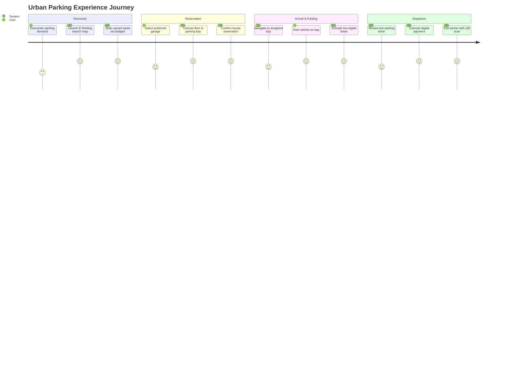
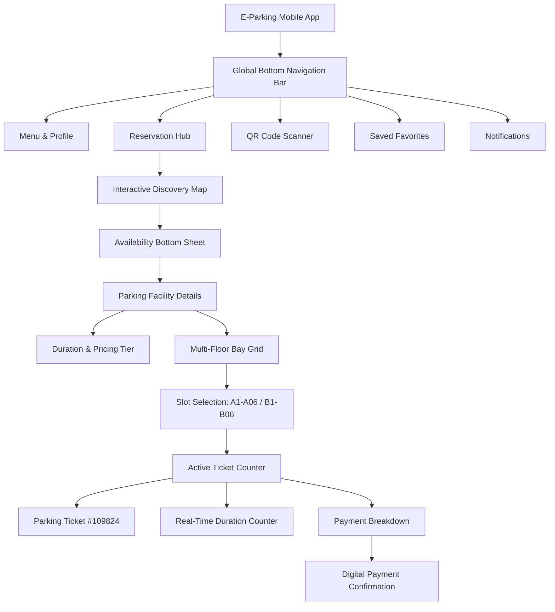
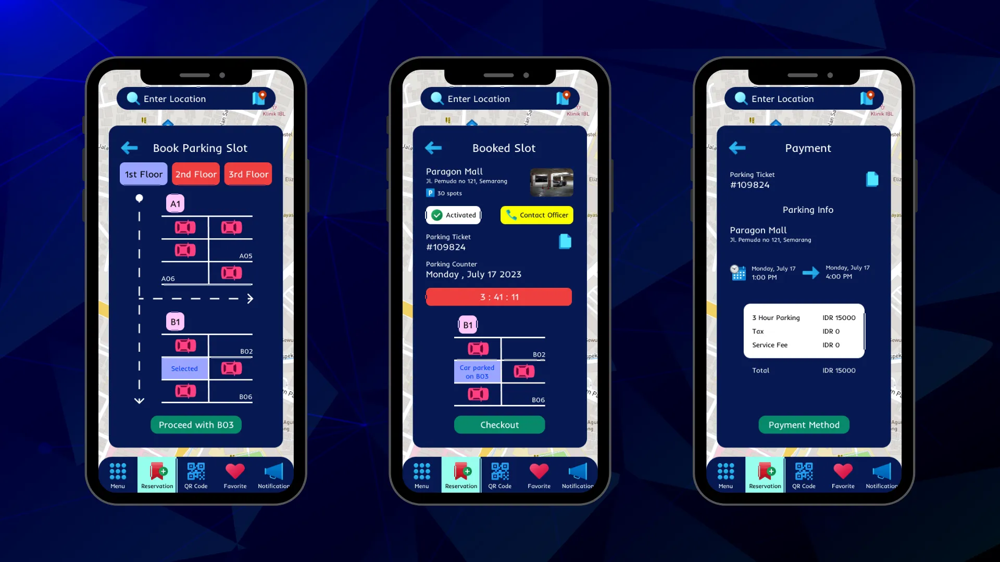

# E-Parking Mobile App UI/UX Design


-green)


## Project Overview

E-Parking is a mobile user interface and experience design concept created to transform urban parking management across dense commercial and municipal centers. By combining real-time parking spot discovery, multi-floor parking bay selection, digital ticketing with live countdown tracking, and integrated contactless payments, the application streamlines the entire parking journey for urban motorists. The product interface bridges the information gap between parking facility managers and vehicle drivers, minimizing time spent cruising for vacant spaces, cutting down inner-city carbon emissions, and eliminating congestion bottlenecks at parking entry and exit barriers.

## Problem Statement & Objectives

Urban motorists in growing commercial hubs face persistent frustration when attempting to locate and secure parking spaces during peak commuting hours. Conventional parking systems lack real-time visibility, forcing drivers to circle parking structures blindly, causing traffic congestion, excessive fuel consumption, and stress.

Key design objectives established for this project:

- **Eliminate Parking Search Friction**: Provide drivers with instantaneous visual feedback on parking availability across nearby commercial lots and multi-story structures.
- **Enable Floor-Level Precision**: Design an intuitive, multi-level bay mapping system that allows users to reserve specific, numbered parking bays before arriving.
- **Modernize Parking Validation**: Replace easily misplaced physical paper tickets with an encrypted digital parking ticket featuring active timekeeping.
- **Streamline Billing & Checkout**: Facilitate transparent in-app payments with instant itemized cost breakdowns to ensure swift, contactless vehicle departure.

## Project Type & Design Approach

This project is a mobile application product design endeavor executed through a User-Centered Design (UCD) framework. The approach emphasizes empathetic user research, iterative wireframing, high-fidelity UI prototyping in dark mode, and rigorous usability validation.

| Attribute | Specification |
| :--- | :--- |
| **Project Type** | Mobile Application Design |
| **Supporting Discipline** | Product Design & Interaction Design |
| **Design Approach** | User-Centered Design (UCD) & Design Thinking |
| **Target Platform** | Mobile (iOS & Android) |
| **Primary Tool** | Figma |
| **Main Deliverable** | High-Fidelity UI Screens & Interactive Mockups |

## Target Audience & User Needs

The primary target audience comprises motorists navigating dense commercial, governmental, and shopping districts who require dependable parking solutions.

Key user groups and their core operational needs include:

- **Daily Office Commuters**: Professionals requiring rapid, predictable morning parking near business centers without uncalculated delays.
- **Retail & Mall Shoppers**: Weekend visitors and families visiting busy commercial hubs who need guaranteed parking spot reservations in advance.
- **Fleet & Courier Drivers**: Delivery and service vehicle operators who require quick short-duration stops and clear navigational guidance.
- **Core User Needs**: Live vacancy statuses, transparent hourly pricing tiers, accessible parking spot indications (disabled bays and elevator proximity), and fast digital checkout.

## User Research & Insights

Formative user interviews and contextual inquiries were conducted with urban motorists to identify critical behavioral patterns and pain points during peak parking hours.

| Method | Target Scope | Key Observation | Design Insight |
| :--- | :--- | :--- | :--- |
| **Contextual Inquiry** | 12 Urban Drivers in Mall Garages | Drivers spent an average of 14–22 minutes circling crowded parking floors looking for empty bays. | Visual floor-level spot maps with occupied/vacant indicators drastically reduce cognitive search fatigue. |
| **User Interviews** | Commuters & Shoppers | 82% of participants expressed anxiety over unexpected parking fee surcharges and lost paper tickets. | In-app parking ticket counters with upfront hourly pricing ensure financial clarity and trust. |
| **Task Flow Analysis** | Entry Barrier Interaction | Physical ticketing creates long vehicle queues spilling into main municipal traffic lanes. | Pre-booking and QR-code barrier scanning reduce barrier dwell time to under 5 seconds. |

## User Personas & Journey Mapping

Based on qualitative research synthesis, user personas were formulated to anchor interface decisions against realistic commuter behaviors.

| Persona Attribute | Persona Profile: Ahmad Fauzi | Persona Profile: Clarissa Dewi |
| :--- | :--- | :--- |
| **Role & Context** | Corporate Business Executive (Age 32) | Creative Designer & Weekend Shopper (Age 26) |
| **Primary Goal** | Secure reliable morning parking within 2 minutes of arrival near office towers. | Locate parking spots close to mall elevators with secure CCTV surveillance. |
| **Major Frustrations** | Unpredictable full parking signs after queueing at garage entrances. | Losing printed ticket receipts and standing in line at manual payment kiosks. |
| **Key App Feature** | One-tap parking bay reservation and automated digital receipt logging. | Visual parking floor maps with spot highlighting and digital wallet payment. |



## Design Scope & Deliverables

The design scope encompasses end-to-end interface design for the core motorist journey, covering discovery, spot selection, real-time ticket management, and payment checkout.

| Deliverable | Description | Status / Location |
| :--- | :--- | :--- |
| **Interactive Map Interface** | Geolocation map screen with facility markers and bottom discovery sheet | Completed (`screenshot/image1.webp`) |
| **Parking Facility Detail Modal** | Facility overview, photo preview, distance, available capacity, and rate selector | Completed (`screenshot/image1.webp`) |
| **Multi-Floor Bay Selection Grid** | Floor-level layout (A/B rows) with occupied status and bay selection | Completed (`screenshot/image2.webp`) |
| **Active Parking Ticket & Timer** | Active ticket counter with live duration display, parking ID, and officer hotline | Completed (`screenshot/image2.webp`) |
| **Payment Summary & Checkout** | Transparent cost breakdown, parking time window, and checkout confirmation | Completed (`screenshot/image2.webp`) |
| **Design System Components** | Atomic UI components, status pills, dark mode palettes, and icon sets | Completed (`Figma Archive`) |

## Information Architecture & Sitemap

The application follows a shallow information hierarchy designed for rapid single-handed operation while driving or walking toward a vehicle.



## Design System & Component Library

A cohesive, modern dark-themed design system was constructed to guarantee high visual contrast and legibility under varying daylight and nighttime driving conditions.

| Component / Element | Variant / State | Purpose & Accessibility Rule |
| :--- | :--- | :--- |
| **Navigation Bar** | Active, Default, Hover | Persistent bottom bar with 5 key destinations, minimum 48dp touch targets. |
| **Availability Pill Badges** | `EMPTY` (Green), `FULL` (Red) | High-contrast status chips (`#00C896` / `#EF4444`) indicating real-time vacancy. |
| **Parking Bay Cards** | Available, Selected, Occupied | Visual parking bay slots with distinct car iconography and highlighted selection. |
| **Primary Action Buttons** | Default, Pressed, Disabled | Rounded CTA buttons (`Proceed with B03`, `Book Parking Slot`, `Checkout`). |
| **Live Counter Display** | Active Countdown (`#EF4444`) | Prominent digital timer widget highlighting current parking duration. |

## Design Tokens & Asset Library

Design tokens ensure systematic styling consistency across typography, elevation, spacing, and semantic color roles.

| Token Category | Token Identifier | Value | Semantic Role |
| :--- | :--- | :--- | :--- |
| **Color** | `color-bg-canvas` | `#0B132B` | Core application dark background canvas |
| **Color** | `color-surface-card` | `#1C2541` | Elevated container and modal surface background |
| **Color** | `color-accent-primary` | `#00C896` | Primary action buttons and available slot badges |
| **Color** | `color-status-danger` | `#EF4444` | Full capacity badges and active parking counter |
| **Color** | `color-status-warning` | `#F59E0B` | Contact officer actions and alerts |
| **Color** | `color-text-primary` | `#FFFFFF` | Primary headings and prominent titles |
| **Color** | `color-text-muted` | `#94A3B8` | Subtitles, addresses, and secondary metadata |
| **Spacing** | `spacing-base` | `8px` | Baseline 8pt spatial grid system |

```json
{
  "theme": "dark",
  "palette": {
    "background": "#0B132B",
    "surface": "#1C2541",
    "primary": "#00C896",
    "danger": "#EF4444",
    "warning": "#F59E0B",
    "textPrimary": "#FFFFFF",
    "textMuted": "#94A3B8"
  },
  "typography": {
    "fontFamilyHeading": "Poppins, sans-serif",
    "fontFamilyBody": "Inter, sans-serif"
  }
}
```

## Design Solution & Key Features

The design solution re-engineers urban parking into a predictable, transparent digital workflow through five core features:

- **Geolocation-Driven Parking Discovery**: An interactive map view displaying nearby parking facilities with real-time vacancy status indicators (`EMPTY` vs `FULL`).
- **Detailed Facility Profiles with Transparent Rates**: Modal previews providing distance metrics, operational hours, security amenities (CCTV, guards, disabled access), and upfront hourly pricing tiers (1h: IDR 5,000, 2h: IDR 10,000, 3h: IDR 15,000).
- **Floor-by-Floor Interactive Bay Selection**: An architectural floor map (1st, 2nd, 3rd Floor) displaying occupied vehicle spaces, traffic circulation arrows, and selectable empty bays (e.g., Bay B03).
- **Live Digital Ticket & Timekeeping Counter**: A paperless digital parking ticket (`#109824`) featuring active validation status, officer emergency contact hotline, and a real-time countdown timer.
- **Frictionless In-App Payment Breakdown**: Itemized financial summaries outlining parking duration fees, zero hidden charges, and immediate digital checkout.

## UX Writing & Content Strategy

Microcopy across the application emphasizes clarity, urgency reduction, and reassurance for drivers operating vehicles.

| UI Element | Microcopy Text | Design Rationale & Tone |
| :--- | :--- | :--- |
| **Availability Badges** | `EMPTY` / `FULL` | Instant, monosyllabic visual distinction preventing driver confusion at a glance. |
| **Selection CTA** | `Proceed with B03` | Explicitly confirms the chosen bay code to reinforce user confidence before booking. |
| **Hotline Action** | `Contact Officer` | Reassures motorists that on-site physical support is immediately reachable. |
| **Timer Header** | `Parking Counter` | Clear descriptive label paired with live clock metrics to prevent surprise overstay fees. |
| **Fare Breakdown** | `3 Hour Parking - IDR 15000` | Transparent cost itemization eliminating hidden administrative fee suspicions. |

## Design Workflow

The project progressed through an agile, user-focused design lifecycle from initial discovery through finalized interactive prototypes:

1. **Problem Exploration & Field Observation**: Conducted contextual observations of parking bottlenecks and motorist behaviors in commercial parking zones.
2. **Information Architecture & Wireframing**: Mapped user journey flows and structured low-fidelity wireframes prioritizing rapid single-handed accessibility.
3. **Design System & Component Styling**: Established dark-themed color palettes, typographic hierarchies, and atomic button/badge components in Figma.
4. **High-Fidelity Interface Design**: Crafted full-resolution screens for map discovery, parking bay selection, digital ticketing, and payment screens.
5. **Interactive Prototyping & Flow Linking**: Connected UI screens into interactive click-through prototypes simulating complete driver reservation journeys.
6. **Usability Validation & Design Refinements**: Tested prototype usability with representative motorists and refined bay selection visibility and touch target spacing.

## Design Tools & Tech Stack

| Category | Tool / Technology | Purpose |
| :--- | :--- | :--- |
| **UI/UX Design Tool** | Figma | End-to-end user interface layout, wireframing, and component library creation |
| **Prototyping** | Figma Interactive Components | Micro-interactions, floor tab switching, and prototype flow demonstrations |
| **User Flow & Architecture** | FigJam & Whimsical | Information architecture mapping, user journey diagrams, and flowcharting |
| **Asset Preparation** | Adobe Illustrator | Vector vehicle icons, architectural parking markers, and custom visual badges |
| **Image Optimization** | WebP Format | High-performance, lossless visual screen documentation for GitHub repository |

## Design Preview

The high-fidelity interfaces illustrated below demonstrate the core user flows of the E-Parking mobile platform.

### 1. Interactive Map Discovery & Parking Availability Workflow

The discovery phase presents an interactive municipal map centering on the user's current GPS location with an omnipresent location search bar and persistent navigation tabs. Expanding the bottom modal surfaces a ranked list of nearby facilities (such as Pandanaran Sky Bridge and Paragon Mall) with immediate real-time vacancy indicators (`EMPTY` vs `FULL`). Tapping a facility opens a comprehensive detail view displaying physical amenities (CCTV, security guards, wheelchair accessibility, elevator lifts), distance calculations, and tiered hourly parking fees before initiating the reservation.

### 2. Multi-Floor Bay Reservation & Digital Ticket Checkout Flow

The transactional phase guides users through a multi-floor parking bay grid (1st, 2nd, and 3rd Floor) with distinct vehicle occupation markers and directional traffic flow indicators, allowing motorists to reserve exact parking bays (e.g., Bay B03). Once activated, the digital ticket screen displays ticket ID `#109824`, live countdown timekeeping (`3:41:11`), and on-site officer assistance. Concluding the session opens the itemized payment summary, presenting transparent duration-based billing and instant digital checkout.

## Interactive Prototyping

Interactive flows were constructed in Figma to validate usability and eliminate cognitive hesitation during parking reservation and payment.

| Prototype Flow | Starting State | Target Goal | Validation Focus |
| :--- | :--- | :--- | :--- |
| **Facility Discovery Flow** | Map Discovery Screen | Parking Detail Sheet | Speed of identifying vacant facilities via color-coded badges. |
| **Bay Selection Flow** | Floor Selector Tabs | Bay Confirmation (`Proceed`) | Precision in toggling between 1st/2nd/3rd floors and selecting vacant bays. |
| **Ticket & Checkout Flow** | Active Ticket Counter | Payment Confirmation | Clarity of live counter duration and transparency of itemized parking fees. |

## Usability Testing & Findings

A moderated usability study with 6 urban motorists was conducted on the interactive prototype to evaluate task completion efficiency and interface comprehension.

| Test Focus Area | Test Method | Key Observed Finding | Design Iteration Applied |
| :--- | :--- | :--- | :--- |
| **Vacancy Badge Recognition** | Task-Based Scenario | Users identified `EMPTY` green pills 60% faster than standard numerical counters alone. | Retained bold, capitalized text pills combined with high-contrast color fills. |
| **Floor & Bay Selection** | Bay Booking Simulation | Initial bay icons lacked clear occupied vs vacant visual differentiation in dim lighting. | Added distinctive pink/red vehicle silhouettes to occupied bays and glowing borders to selected bays. |
| **Active Ticket Visibility** | Timer Monitoring | Users wanted immediate confirmation that their parking session was officially counted. | Elevated the `Activated` status chip with a green badge and positioned a large red timer card prominently. |

## Accessibility Audit

An accessibility evaluation was conducted aligned with WCAG 2.1 Level AA digital mobile interface standards.

| Criterion | Evaluation Target | Audit Finding | Remediation & Implementation |
| :--- | :--- | :--- | :--- |
| **Color Contrast (1.4.3)** | Body text & badge labels | Text on card surfaces achieved a contrast ratio exceeding 7.2:1 against `#1C2541`. | Complies fully with WCAG AAA standards for text legibility. |
| **Touch Target Size (2.5.5)** | Bottom nav icons & bay cards | Interactive targets measure at least 48x48dp to prevent accidental taps while driving. | Ensured generous padding around all primary CTA and selection buttons. |
| **Non-Text Contrast (1.4.11)** | Parking bay status graphics | Bay occupancy utilizes dual encoding (car iconography + color coding + text labels). | Eliminates reliance on color alone for color-blind motorists. |

## Competitive Analysis & Benchmarking

The design was benchmarked against existing municipal and private smart parking applications to identify competitive differentiation opportunities.

| Evaluation Metric | E-Parking Mobile App | Conventional Parking Apps | Manual Barrier Paper Ticket |
| :--- | :--- | :--- | :--- |
| **Real-Time Spot Availability** | Instant color-coded badges | Numerical counts only | None (Entry gate display only) |
| **Specific Bay Reservation** | Exact bay selection (e.g., B03) | Area-level reservation only | None (Manual searching) |
| **Digital Ticket Tracking** | In-app live counter & ticket ID | Static QR code receipt | Physical disposable paper ticket |
| **Payment Integration** | In-app itemized digital billing | Third-party payment redirects | Manual cash / card kiosk queues |

## Contributing

Contributions, design suggestions, and feedback are welcome. Please follow this standard collaboration workflow:

1. Fork the repository.
2. Create a branch for the change (`git checkout -b feature/design-improvement`).
3. Make the changes.
4. Check that relevant design files, assets, and documentation are organized correctly.
5. Commit and push the branch (`git push origin feature/design-improvement`).
6. Open a pull request with a clear explanation and relevant previews when applicable.

## Developer Handoff & Implementation Guidelines

To ensure seamless front-end implementation in Flutter or React Native, design tokens and layout specifications have been structured systematically.

| Design Element | Specification & Implementation Rule | Developer Reference |
| :--- | :--- | :--- |
| **Layout Grid** | 4-column responsive mobile layout with 16px lateral margins and 8px baseline grid. | `Figma Layout Guides` |
| **Typography Scale** | Poppins (Headings: 24px Bold, 18px SemiBold) & Inter (Body: 14px Regular, Badges: 11px Medium). | `Design Tokens JSON` |
| **Icon Assets** | SVG format with bounding box 24x24dp, exported with vector paths stroke 1.5px. | `assets/icons/` |
| **Card Components** | Border radius `16px`, container background `#1C2541`, zero external drop-shadow for performance. | `Component Library` |

## License

This project is licensed under the MIT License.
See the [LICENSE](LICENSE) file for details.

## Author & Contact

**Yohanes Dimas Pratama**

- GitHub: [github.com/weztcy](https://github.com/weztcy)
- Portfolio: [yohanesdimas.com](https://yohanesdimas.com)
- LinkedIn: [linkedin.com/in/yohanes-dimas](https://www.linkedin.com/in/yohanes-dimas)
