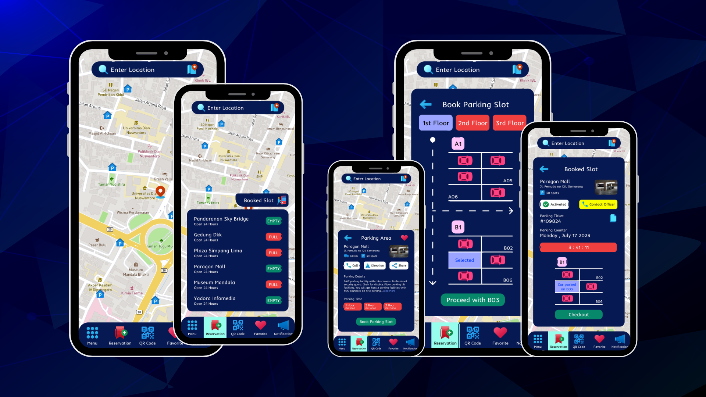
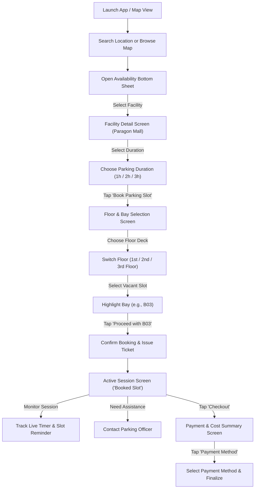

# E-Parking Mobile App UI/UX Design

## Project Description

**E-Parking Mobile App** is a high-fidelity mobile application UI/UX concept engineered to solve urban parking congestion, minimize driver transit anxiety, and streamline spot reservations. Designed with an ergonomic dark-mode aesthetic tailored for vehicular glanceability and low-light cabin environments, the application empowers motorists to discover nearby parking facilities, monitor real-time slot availability, reserve dedicated parking bays before arrival, and track parking sessions with live automated countdown counters.

This repository encompasses high-fidelity mobile interface designs, spatial floor layouts, detailed component systems, and curated presentation mockups designed for modern edge-to-edge smartphones.

---

## Project Overview

Finding vacant parking in densely populated urban centers, shopping hubs, and central business districts is often a stressful, time-consuming ordeal that produces unnecessary traffic bottlenecks and carbon emissions. Traditional parking workflows suffer from opaque availability information, confusing multi-level garage layouts, and cumbersome paper-based validation tickets.

The **E-Parking Mobile App** conceptualizes a unified digital parking ecosystem covering the complete motorist journey across three distinct stages:
1. **Pre-Arrival Discovery**: Real-time map-based spatial search and destination availability tracking.
2. **Bay Reservation & Navigation**: Multi-floor layout inspection with spot-level selection (e.g., Bay B03) and upfront duration booking.
3. **Session Management & Contactless Exit**: Live ticket monitoring with automated elapsed timers, direct officer communication, and streamlined checkout.

*Note: This repository contains high-fidelity UI/UX design deliverables, mockups, and screen presentations; it does not include an active backend service or compiled mobile codebase.*

---

## Problem Statement & Design Goals

### Problem Statement
- **Blind Parking Searches**: Drivers enter parking garages without knowing current capacity, leading to aimless circling and elevated roadway congestion.
- **Orientation Friction in Multi-Level Garages**: Traditional signage is often difficult to read from moving vehicles, causing confusion across multiple basement and elevated decks.
- **Vulnerability to Overstay Penalties**: Drivers lose track of elapsed parking time, resulting in unexpected surcharges or ticket penalties.
- **Driver Distraction & High-Glare Interfaces**: Overly bright, cluttered mobile screens cause glare and visual fatigue when consulted inside vehicles or at night.

### Design Goals
- **Glanceable Dark Theme**: Establish a deep midnight navy interface paired with high-contrast neon accents (emerald green, coral red, and cyan) that maximizes legibility and minimizes driver distraction.
- **Real-Time Availability Signifiers**: Utilize color-coded status badges (`EMPTY` vs. `FULL`) to communicate facility vacancy within milliseconds.
- **Interactive Spatial Bay Selection**: Provide an intuitive bird's-eye schematic of garage floors allowing drivers to select their exact designated bay.
- **Transparent Session Telemetry**: Feature an active parking ticket dashboard with a live countdown timer, clear vehicle placement markers, and single-tap checkout.

---

## Target Users & User Needs

### User Personas
- **The Daily Urban Commuter**: Commutes to congested downtown business districts (e.g., Jl. Pemuda, Simpang Lima) and requires guaranteed, pre-booked parking to avoid arriving late for meetings.
- **The Weekend Shopper & Family Driver**: Drives to major retail complexes (e.g., Paragon Mall) and needs instant clarity on facility amenities, elevator access, security, and child-safe pedestrian corridors.
- **The Event & Entertainment Visitor**: Visits civic or historic landmarks (e.g., Lawang Sewu, Museum Mandala) during high-traffic hours and relies on immediate availability filters to locate open parking spaces.

### Core User Needs
- Rapid location-based discovery via an interactive map with contextual search.
- Unambiguous visual indicators showing whether a parking destination has open spots.
- Direct facility intelligence, including distance, total capacity, hourly pricing tiers, and accessibility services.
- Visual floor plans enabling specific slot selection to avoid on-site searching.
- Live parking session tracking with ticket number reference and elapsed duration.

---

## Design Goals & Key Features

### 1. Interactive Urban Map & Location Search
- **Persistent Location Input**: Top-anchored search bar ("Enter Location") accompanied by quick geolocation access.
- **Contextual Map Markers**: Vector map pins displaying parking designations across key urban districts in Semarang.
- **Thumb-Friendly Bottom Navigation**: Five dedicated navigation destinations: Menu, Reservation (active highlight), QR Code Scanner, Favorites, and Notifications.

### 2. Live Parking Availability Bottom Sheet
- **Instant Capacity Triage**: Scrollable modal sheet featuring nearby parking destinations (e.g., Pandaranan Sky Bridge, Gedung Dkk, Plaza Simpang Lima, Paragon Mall).
- **Color-Coded Badges**: High-contrast green `EMPTY` pills for open destinations and red `FULL` pills for occupied facilities.
- **One-Tap Active Shortcut**: Floating pill shortcut providing direct access to currently booked tickets.

### 3. Comprehensive Parking Facility Details
- **Facility Overview Card**: Detailed venue information including street address, real-time distance (600m), total capacity (30 spots), and facility exterior photograph.
- **Quick Action Bar**: Integrated quick triggers for calling venue reception, launching turn-by-turn navigation, and sharing parking coordinates.
- **Amenities & Security Disclosure**: Clear bulleted disclosures covering 24/7 CCTV surveillance, professional security staff, wheelchair accessibility, and elevator access.
- **Hourly Pricing Selector**: Segmented duration selector pills for 1-hour (IDR 5,000), 2-hour (IDR 10,000), and 3-hour (IDR 15,000) sessions.

### 4. Interactive Floor Schematic & Spot Selection
- **Multi-Level Deck Selector**: Segmented floor switcher tabs supporting 1st Floor, 2nd Floor, and 3rd Floor decks.
- **Bay Layout Schematic**: Top-down architectural floor plan detailing driving lanes, directional arrows, and designated parking rows (Bay A and Bay B).
- **Occupancy Visualization**: Graphic red vehicle silhouettes indicating occupied slots, with unshaded regions indicating open spaces.
- **Selected Slot Highlight**: Dynamic slot highlight marking the user's chosen bay (e.g., `B03`) with a dedicated confirmation action ("Proceed with B03").

### 5. Active Session Management & Live Countdown
- **Active Booking Verification**: Prominent `Activated` status pill and immediate officer assistance link ("Contact Officer").
- **Unique Digital Ticket Reference**: Displayed parking ticket identification number (`#109824`) with quick copy utility.
- **Live Parking Counter**: Prominent coral-toned digital clock tracking elapsed and remaining parking time (`3 : 41 : 11`).
- **Slot Positioning Reminder**: Simplified bay schematic pinpointing exactly where the user's vehicle is parked (`Car parked on B03`).

### 6. Transparent Checkout & Payment Summary
- **Reservation Summary Card**: Verified schedule card detailing booking window (Monday, July 17 from 1:00 PM to 4:00 PM).
- **Itemized Cost Breakdown**: Transparent fee accounting listing baseline duration parking fees, municipal taxes, and service fees with zero hidden surcharges.
- **Payment Method Entrypoint**: Primary CTA button routing drivers to contactless payment options (e-wallets, credit cards, QRIS).

---

## Design Preview & Showcase

### Screen Flow 1: Discovery, Availability & Facility Inspection

The initial user journey focuses on geographic spot identification, real-time status filtering, and comprehensive facility inspection:

*Figure 1: High-fidelity screens displaying (Left) Urban Map & Search Overview, (Center) Live Parking Availability Bottom Sheet, and (Right) Facility Details & Duration Selection.*

---

### Screen Flow 2: Spot Reservation, Active Session & Digital Payment

The reservation and checkout journey provides clear spatial guidance, real-time session tracking, and seamless financial settlement:

*Figure 2: High-fidelity screens displaying (Left) Multi-Level Bay Selection Grid, (Center) Active Session & Live Countdown Timer, and (Right) Itemized Checkout & Payment Summary.*

---

## UX Research & Insights

The user experience architecture of **E-Parking Mobile App** is guided by ergonomic interaction patterns and cognitive load principles relevant to drivers:

- **In-Vehicle Glanceability**: Drivers interact with mobile navigation in short 1-to-2 second glances. The interface utilizes high-contrast color signifiers and large typographic hierarchy to communicate slot availability without requiring prolonged visual fixation.
- **Spatial Wayfinding vs. Abstract Lists**: Providing an architectural top-down layout of parking bays bridges the mental model gap between digital booking and physical garage navigation, ensuring drivers immediately know where to steer upon entering the gate.
- **Reduction of Time Anxiety**: Overstay anxiety is a primary psychological pain point during parking. Placing an unmissable live digital timer on the active session screen gives users real-time certainty over their remaining reservation duration.
- **Color Signifier Consistency**: Standard traffic conventions are strictly respected: green signifies availability/confirmation, red indicates full capacity/occupied bays, and cyan represents user-selected elements.

---

## User Flow & Information Architecture

### User Journey Flow

### Information Architecture

- **Map Discovery Layer**:
  - Top Search Input ("Enter Location") & Geolocation Trigger
  - Interactive Map Pins with Geographic Anchors
  - Persistent Bottom Navigation Bar (Menu, Reservation, QR Code, Favorite, Notification)
- **Facility Availability Layer**:
  - Real-Time Destination List with Status Pills (`EMPTY` / `FULL`)
  - Shortcut to Current Booked Tickets
- **Facility Detail Layer**:
  - Venue Imagery, Street Address, Distance, and Capacity
  - Quick Contacts (Call, Directions, Share)
  - Security & Accessibility Amenity Specifications
  - Duration Selection Pills (1h / 2h / 3h with IDR Rates)
- **Spatial Floor Layer**:
  - Deck Selector Tabs (1st, 2nd, 3rd Floor)
  - Architectural Bay Layout with Lanes and Directional Indicators
  - Occupancy Visualization (Occupied Silhouettes vs. Open Bays)
  - Selected Bay Identifier & Proceed CTA
- **Active Session Layer**:
  - Status Indicator (`Activated`) & Officer Assistance Button
  - Digital Ticket Reference (`#109824`)
  - Digital Countdown Clock (`3 : 41 : 11`)
  - Vehicle Location Diagram (`Car parked on B03`)
- **Checkout & Settlement Layer**:
  - Booking Time Interval (Start Time -> End Time)
  - Itemized Tariff Breakdown (Parking Fee, Tax, Service Fee, Total)
  - Payment Method Trigger

---

## Wireframes & Prototypes

- **Design Fidelity**: High-Fidelity UI Mockups & Architectural Schematics.
- **Prototyping Status**: Complete high-fidelity mockups depicting the end-to-end user flow from initial location search through to garage spot reservation, session telemetry, and checkout.
- **Deliverable Formats**: High-resolution rendered screen exports and presentation compositions suitable for design system implementation and stakeholder reviews.

---

## UI Design & Screens

### 1. Interactive Map & Discovery Screen
Serves as the primary landing canvas. A full-screen vector street map displays nearby urban landmarks in Semarang alongside designated parking markers. The top search container allows manual address inputs, while the persistent bottom navigation keeps key app functions within reach.

### 2. Real-Time Availability Bottom Sheet
Presents an aggregated list of parking garages and open-air lots within proximity. Each listing displays facility name, operating hours ("Open 24 Hours"), and an instantaneous availability pill badge (`EMPTY` in green or `FULL` in red), allowing drivers to make rapid route decisions.

### 3. Facility Detail & Duration Configuration Screen
Provides granular operational details for a selected destination (Paragon Mall). Drivers review physical garage photographs, distance metrics, total spot counts, security credentials, and disability accommodations before configuring their anticipated stay duration via segmented duration chips (1, 2, or 3 hours).

### 4. Interactive Floor & Bay Selection Screen
Offers a clean 2D architectural representation of the parking floor plan. Drivers can toggle between deck levels (1st Floor, 2nd Floor, 3rd Floor) and inspect individual rows. Occupied bays are visually blocked out with red vehicle markers, while available slots can be tapped to lock in reservations (highlighting slot `B03`).

### 5. Active Session & Live Timer Screen ("Booked Slot")
Acts as the driver's digital parking pass while parked. Prominently displays the active ticket number (`#109824`), an elapsed/remaining countdown timer (`3 : 41 : 11`), a reminder schematic showing where the vehicle was left (`B03`), and a direct contact button for on-site garage officers.

### 6. Payment & Cost Summary Screen
Summarizes the concluded or booked parking session. Displays the precise timestamp interval (e.g., Monday, July 17 from 1:00 PM to 4:00 PM) paired with a transparent cost breakdown (IDR 15,000 Total) free of hidden surcharges, leading directly to payment execution.

---

## Design System & Components

### Color Palette

| Color Role | Hex Code | Visual Sample | Application |
| :--- | :--- | :--- | :--- |
| **Midnight Navy Surface** | `#0B132B` / `#10182F` | Deep Dark Blue | Primary canvas background, modal sheets, and card containers |
| **Accent Emerald Green** | `#10B981` | Bright Mint Green | Primary action CTAs, `EMPTY` vacancy badges, `Activated` indicators |
| **Alert Coral Red** | `#EF4444` / `#E63946` | Vibrant Crimson | `FULL` capacity badges, occupied vehicle markers, timer card background |
| **Electric Cyan** | `#06B6D4` / `#38BDF8` | Bright Sky Blue | Active bottom navigation tab, selected slot outline, map route accents |
| **Assistance Amber Gold** | `#F59E0B` | Warm Yellow | `Contact Officer` button, warning indicators |
| **High-Contrast Text Light** | `#FFFFFF` / `#E2E8F0` | Pure & Slate White | Primary headers, numeric counters, button typography |

### Typography

- **Display & Headings**: Bold, geometric modern sans-serif optimized for crisp rendering at large scale on dark backgrounds.
- **Body & Captions**: Regular and medium weights with elevated line-height to guarantee effortless reading under variable ambient vehicle lighting.
- **Numeric & Telemetry Labels**: Prominent monospaced or tabular figures for ticket IDs (`#109824`), timer readouts (`3:41:11`), and monetary totals (`IDR 15,000`).

### Core UI Components

- **Search Bar Container**: Rounded input field featuring search and route iconography against a contrasting navy surface.
- **Status Indicator Badges**: Pill-shaped badges utilizing dual-channel differentiation (text label + color fill) for instant cognitive parsing.
- **Duration Selector Chips**: Segmented pill buttons displaying duration and corresponding Indonesian Rupiah (IDR) pricing.
- **Interactive Bay Nodes**: Rectangular parking stalls featuring lane dividers, bay designations (`A01`–`B06`), and vehicle silhouette states.
- **Telemetry Counter Card**: High-visibility pill container housing the digital timer for immediate status recognition.
- **Ergonomic Bottom Navigation Bar**: Anchored dark container hosting intuitive vector icons for Menu, Reservation, QR Scanner, Favorites, and Notifications.

---

## Interaction Design & States

- **Floor Switcher Tab States**: Active floor (`1st Floor`) is emphasized with an energetic light blue pill, while inactive floors (`2nd Floor`, `3rd Floor`) display a muted coral tone.
- **Slot Selection State**: Tapping an open bay changes its status outline from unselected to electric cyan with a distinct `Selected` label, immediately updating the bottom CTA label to "Proceed with B03".
- **Real-Time Capacity States**: Facilities dynamically reflect vacancy status through green `EMPTY` or red `FULL` pill tags.
- **Active Session Telemetry**: The countdown counter dynamically displays elapsed/remaining duration, providing reassurance throughout the driver's stay.

---

## Responsive Design & Platform Support

- **Target Form Factors**: Modern edge-to-edge iOS and Android smartphones.
- **Display Optimization**: Calibrated for high-DPI OLED/AMOLED mobile displays, where deep navy surfaces conserve battery life and enhance visual depth.
- **Ergonomic Touch Targets**: All interactive touch targets (floor tabs, bay nodes, duration chips, CTAs) strictly conform to the minimum 44×44 pt touch standard for one-handed operation.

---

## Accessibility & Usability Considerations

- **High-Contrast Ratio**: Text, iconography, and interactive elements maintain strong contrast against dark navy surfaces, complying with WCAG AA/AAA legibility standards.
- **Dual-Channel Status Coding**: Vacancy states do not rely solely on color; both distinct typographic text (`EMPTY` / `FULL`) and color coding (green / red) are paired together to support color-blind drivers.
- **Accessibility Amenities Transparency**: Facility details explicitly highlight accessible accommodations, including wheelchair-accessible elevators and reserved disability parking bays.
- **Thumb-Zone Placement**: Primary conversion actions ("Book Parking Slot", "Proceed with B03", "Checkout", "Payment Method") are pinned to the bottom thumb-friendly zone.

---

## Design Tools & Assets

- **Design Tooling**: Modern vector UI/UX design software (Figma).
- **Iconography & Visual Assets**: Custom vector iconography for automotive navigation, facility amenities, QR verification, and parking bay schematic silhouettes.
- **Export Formats**: High-resolution PNG visual deliverables rendered for presentation showcases, documentation, and portfolio displays.

---

## Design Deliverables

The repository provides the following verified visual design assets:
- **Presentation Hero Banner**: `./screenshots/banner.png` — Multi-device presentation composition featuring five smartphone mockups against a geometric blue background.
- **Screen Flow Showcase 1**: `./screenshots/E-Parking Mobile App UI_UX Design 1.png` — High-fidelity sequence illustrating Map Search, Parking Spot Availability, and Facility Details.
- **Screen Flow Showcase 2**: `./screenshots/E-Parking Mobile App UI_UX Design 2.png` — High-fidelity sequence illustrating Bay Selection, Active Session Management, and Payment Checkout.

---

## How to View & Use Design Files

- All interface designs and showcase presentations are provided in high-resolution PNG format and render natively on GitHub.
- To inspect specific screen layouts, navigate to the `screenshots/` directory or view the inline previews embedded throughout this document.
- Design assets can be reviewed in any standard image viewer, web browser, or imported into design inspection environments.

---

## Design Decisions & Limitations

- **Dark Mode Prioritization**: The interface is intentionally styled in a dark-mode palette to cater to motorists navigating in underground parking facilities, multistory parking decks, and nocturnal driving environments where bright screens cause glare.
- **Scope & Data Dependency**: Mockup data illustrates parking structures in Semarang, Indonesia (e.g., Paragon Mall, Plaza Simpang Lima) with pricing displayed in Indonesian Rupiah (IDR). In a production deployment, availability counts and floor maps would be dynamically populated by IoT parking bay sensors and automated barrier gate APIs.

---

## License

Please see the [LICENSE](./LICENSE) file for the terms and conditions governing the use, modification, and distribution of this project.

## Author & Contact

**Yohanes Dimas Pratama**

- GitHub: [github.com/weztcy](https://github.com/weztcy)
- Portfolio: [dimaspratama.vercel.app](https://dimaspratama.vercel.app)
- LinkedIn: [linkedin.com/in/yohanes-dimas](https://www.linkedin.com/in/yohanes-dimas)
